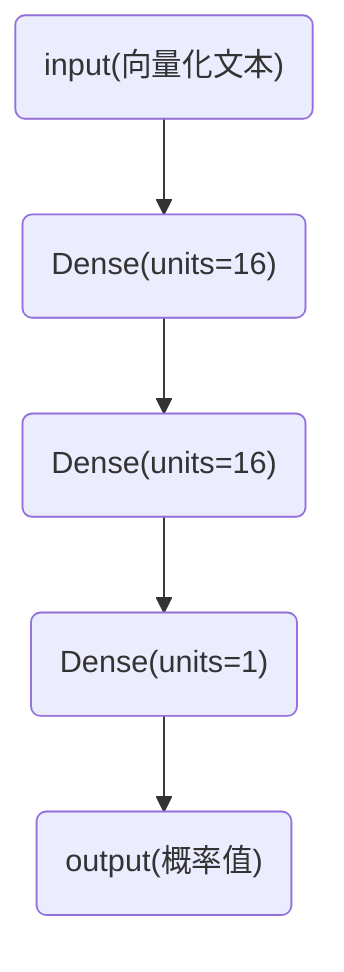

# 4.1 影评分类：二分类问题示例

> 相关代码：[c4_1_影评分类_二分类问题示例.py](../src/c4_1_影评分类_二分类问题示例.py)

## 4.1.1 IMDB数据集

本节将使用IMDB数据集，它包含来自互联网电影数据库（IMDB）的50000条严重两极化的评论。数据集被分为25000条用于训练的评论与25000条用于测试的评论，训练集和测试集都包含50%的正面评论和50%的负面评论。

与MNIST数据集一样，IMDB数据集也内置于Keras库中。它已经过预处理：评论已被转换为整数序列，其中每个整数对应字典中的某个单词。这样我们就可以专注于模型的构建、训练和评估。

## 4.1.2 准备数据

不能将整数列表直接传入神经网络。整数列表的长度各不相同，但神经网络处理的是大小相同的数据批量。我们需要将列表转换为张量，转换方法有以下两种：

- 填充列表，使其长度相等，再将列表转换为形状为(samples, max_length)的整数张量，然后在模型第一层使用使用能处理这种整数张量的层（也就是Embedding层）
- 对列表进行multi-hot编码，将其转换为由0和1组成的向量。比如，将序列[8,5]转换成一个10000维向量，只有索引为8和5对应元素是1，，其余元素都是0.然后，模型第一层可以用Dense层，它能够处理浮点数向量数据。

## 4.1.3 构建模型

输入数据是向量，而标签是标量1和0，这是最简单的一类问题。有一类模型在这种问题上的表现很好，那就是带有relu激活函数的密集连接层（Dense）的简单堆叠。

对于Dense层的这种堆叠，需要做出以下两个关键的架构决策：

- 神经网络有多少层
- 每层有多少个单元

第5章将介绍做出上述决策的具体原则。现在我们选择下列架构：

- 两个中间层，每层16个单元；
- 第三层输出一个标量预测值，代表当前评论的情感类别；

架构示意图如下：



传入每个Dense层的第一个参数是该层的单元个数，即该层表示空间的维数。每个带relu激活函数的Dense层都实现了下列张量运算：

```python
output = relu(dot(input, W) + b)
```

16个单元对应的权重矩阵W的形状为`(input_dimension, 16)`，与W做点积相当于把输入数据投影到16维表示空间中。可以将表示空间的维度直观理解为“模型学习内部表示时所拥有的自由度”。单元越多，表示空间的维度越高，模型就能学到更加复杂的表示，模型的计算代价也变得更大，并可能导致学到不必要的模式（这种模式可以提高在训练数据上的性能，但不会提高在测试数据上的性能）。

中间层使用relu作为激活函数，最后一层使用sigmoid激活函数，以便输出一个介于0和1之间的概率值（表示样本目标值等于“1”的可能性，即评论为正面的可能性）。relu函数将所有负值归零，sigmoid函数则将任意值压缩到[0,1]区间内。

> 什么是激活函数？为什么要使用激活函数？
>
> 如果没有像`relu`这样的激活函数（也叫**非线性激活函数**），Dense层就只包含两个线性运算，即点积与加法。
>
> ```python
> output = dot(input, W) + b
> ```
>
> 这样的层只能学习输入数据的线性变换（放射变换）：该层的假设空间是从输入数据到16维空间所有可能的线性变换组合。这种假设空间非常受限，无法利用多个表示层的优势，因为多个现行层堆叠实现的仍是线性运算，增加层数并不会扩展假设空间。
>
> 为了得到更丰富的假设空间，从而充分利用多层表示的优势，需要引入非线性，也就是添加激活函数。`relu`是深度学习中最常用的激活函数，但还有许多其他函数可选，它们都有类似的奇怪名称，比如`prelu`，`elu`等。

最后，需要选择损失函数和优化器。你面对的是一个二分类问题，模型输出是一个概率值，所以最好使用`binary_crossentropy`（二元交叉熵）损失函数。这并不是唯一可行的选择，比如你还可以使用`mean_squared_error`（均方误差）。但对于输出概率值的模型，交叉熵通常是最佳选择。交叉熵是一个来源于信息论领域的概念，用于衡量概率分布之间的距离，在这个例子中就是真实分布与预测值之间的距离。

至于优化器，我们将使用`rmsprop`。对于几乎所有问题，它通常都是很好的默认选择。

接下来的步骤是用 `rmsprop` 优化器和 `binary_crossentropy` 损失函数来配置模型。

```python
model.compile(optimizer="rmsprop",
             loss="binary_crossentropy",
             metrics=["accuracy"])
```

## 4.1.4 验证你的方法

深度学习模型不应该在训练数据上进行评估；标准做法是使用验证集来监控训练过程中的模型精度。下面我们从原始训练数据中留出10000个样本作为验证集。

```python
x_val = x_train[:10000]
partial_x_train = x_train[10000:]
y_val = y_train[:10000]
partial_y_train = y_train[10000:]
```

现在我们将使用由512个样本组成的小批量，对模型训练20轮，即对数据的所有样本进行20次迭代。与此同时，我们还要监控在留出的10000个样本上的损失精度。可以通过`validation_data`参数传入验证数据。

```python
history = model.fit(partial_x_train,
                   partial_y_train,
                   epochs=20,
                   batch_size=512,
                   validation_data=(x_val, y_val))
```

如果在CPU上运行，那么每轮的时间不到2秒，整个训练过程将在20秒内完成。

调用`model.fit()`返回了一个History对象。这个对象有一个名为history的成员，它是一个字典，包含训练过程中的全部数据。

这个字段包含4个条目，分别对应训练过程和验证过程中监控的指标。我们可以使用 matplotlib 在同一张图上绘制训练损失和验证损失，以及训练精度和验证精度。

如你所见，训练损失每轮都在减小，训练精度每轮都在提高。这正是梯度下降优化的预期结果：我们想要最小化的量随着每次迭代变得越来越小。但验证损失和验证精度并非如此，它们似乎在第4轮之后达到峰值。这正是之前警告过的一种情况：模型在训练数据上的表现越来越好，但在前所未见的数据上不一定表现得越来越好。准确地说，这种现象叫作**过拟合**（overfit）：在第4轮之后，你对训练数据做过度优化，最终学到的表示仅针对于训练数据，无法泛化到训练集之外的情况。

在这种情况下，为防止过拟合，你可以在4轮之后停止训练。一般来说，你可以用多种方法来降低过拟合，我们将在第5章介绍。

## 4.1.5 利用训练好的模型对新数据进行预测

训练好一个模型之后，可以用`predict`方法来计算评论为正面的可能性。

```python
model.predict(x_test)
```

## 4.1.6 进一步实验

通过以下实验，可以确信前面选择的神经网络架构是非常合理的，不过仍然有改进的空间。

- 我们在最后的分类层之前使用了两个表示层。可以尝试使用一个或三个表示层，然后观察这么做对验证精度和测试精度的影响。
- 尝试使用更多或更少的单元，比如32个或64个。
- 尝试使用`mse`损失函数替代`binary_crossentropy`。
- 尝试使用`tanh`激活函数（这种激活函数在神经网络早期非常流行）替代`relu`。

---
← 上一节：[3.6 神经网络剖析：了解核心Keras API](3.6-神经网络剖析-了解核心Keras-API.md) · 下一节：[4.2 新闻分类：多分类问题示例](4.2-新闻分类-多分类问题示例.md) → · [总目录](README.md)
